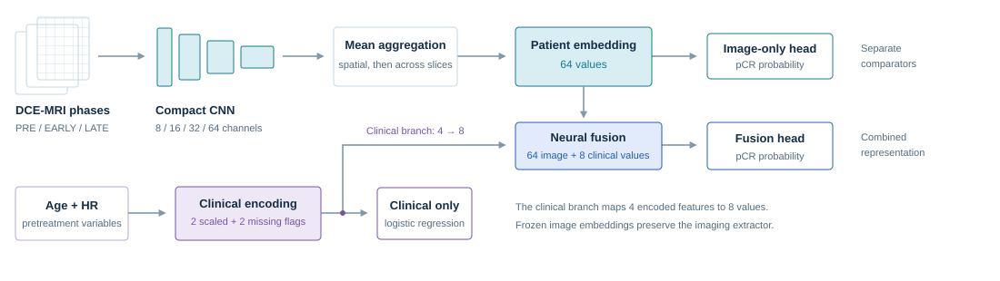
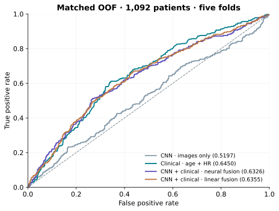

# DCE Research · CNN e IA multimodal

Predicción experimental de respuesta patológica completa en cáncer de mama mediante
resonancia DCE-MRI, una CNN propia y variables clínicas. Proyecto de investigación
y docencia: no demuestra utilidad clínica.

[Abrir la web terminada](https://aledeniiz.github.io/Cancer_mama_Jacinto/)
· [Guía para el profesor](EVALUACION_PROFESOR.md)



## Entrega científica

Este repositorio incluye código, configuraciones, pesos conservados, transformadores,
particiones, metadatos desidentificados del caso público, predicciones OOF/TEST,
embeddings y métricas. Las resonancias se descargan aparte. No se incluyen datos
privados de defensa, entornos virtuales, cachés ni respaldos.

- [Modelos y recarga](models/trained/): CNN EMA, CNN por fold, modelos clínicos OOF
  y cabezas de fusión neuronal conservadas, con procedencia y verificación.
- [Datos y referencias de evaluación](evaluation/): metadatos públicos, particiones,
  predicciones y embeddings para comprobar resultados sin resonancias.
- [Código](src/breastdce_research/) y [comandos](scripts/): arquitectura, tratamiento
  de imágenes, EMA, clínica, fusión, inferencia y comprobaciones.
- [Resultados agregados](results/study.json), [metodología](docs/methodology.md)
  y [limitaciones](docs/limitations.md).
- [Presentación final UAX](presentation/): PowerPoint, PDF, guion y notas,
  conservados sin rediseño; se indican los protocolos distintos.

## Resultados y protocolos

Los cuatro modelos siguientes comparten OOF de cinco folds y 1.092 pacientes
elegibles. No se mezclan con el TEST histórico de la CNN EMA.

| Enfoque | ROC-AUC | BCE |
|---|---:|---:|
| CNN por fold, solo imágenes | 0,5197 | 0,629661 |
| Solo clínica: edad y HR | 0,6450 | 0,577562 |
| CNN + clínica: fusión neuronal | 0,6326 | 0,593395 |
| Fusión lineal | 0,6355 | 0,594180 |

La fusión neuronal mejora numéricamente la CNN aislada, pero **no demuestra una
ventaja sobre el modelo clínico**. La diferencia de AUC fusión menos clínica es
−0,01245, IC bootstrap condicional del 95 % [−0,03777; 0,01113].

La **CNN EMA** obtuvo ROC-AUC **0,5524** y BCE **0,617616** en **176 pacientes
del TEST histórico**, bajo otro protocolo. Ese TEST había sido usado con otros
modelos; no es una validación externa intacta. El modelo multimodal final de
desarrollo no dispone de una estimación independiente de rendimiento.



## Instalar y comprobar

Usar Python 3.11 en un entorno nuevo:

```sh
python -m venv .venv
# Activar .venv según el sistema operativo.
python -m pip install --upgrade pip
python -m pip install torch==2.10.0 --index-url https://download.pytorch.org/whl/cpu
python -m pip install -e ".[test,plots]"
python -B scripts/reproduce_results.py
python -B -m pytest -q -p no:cacheprovider
```

La reproducción comprueba las predicciones originales y sus métricas; no entrena
modelos ni descarga imágenes. Las pruebas de recarga y conservación de parámetros
se documentan junto a los modelos. Para recalcular desde píxeles se necesitan las
resonancias originales. Los embeddings permiten revisar las etapas posteriores al
encoder, pero no prueban por sí solos que la extracción desde imágenes sea correcta.

El entrenamiento histórico utilizó PyTorch 2.5.1. La recarga pública utiliza 2.10.0,
sin modificar arquitectura ni resultados. No se promete una repetición bit a bit
del entrenamiento GPU entre plataformas. Los cargadores usan JSON/NPZ sin pickle.

## Web y uso local

```sh
python -B scripts/serve_web.py --port 8877
```

Abrir `http://127.0.0.1:8877/web/`. Se conserva el diseño de la plataforma terminada.
GitHub Pages sirve una **demostración estática**: no ejecuta Python ni inferencia
real sobre pacientes. Los controles correspondientes están desactivados de forma
explícita. Los pesos y referencias se descargan desde el repositorio, no se
incrustan en la página. Consulte [el contrato de exportación](web/PUBLIC_EXPORT.md)
y [el despliegue](docs/deployment.md).

Para inferencia local, consultar `--help` de `scripts/infer_cnn.py`,
`scripts/infer_clinical.py` y `scripts/infer_multimodal.py`, y los
[ejemplos](examples/README.md). Los cinco modelos clínicos son evaluadores OOF;
no se presentan como un modelo clínico global que no existió.

## Datos

El subconjunto preparado contiene **1.273 pacientes**, **12.703 tripletes**
PRE/EARLY/LATE y **38.109 archivos PNG de fase**. Desarrollo: 1.097 pacientes;
TEST histórico: 176. La comparación clínica/fusión excluye cinco resultados
desconocidos y usa 1.092 pacientes. No son 38.109 observaciones independientes.
El dataset fuente completo descrito en la publicación contiene 2.070 pacientes.

[Acceso original al caso](docs/original-data-access.md)
· [Datos, esquema y procedencia](docs/datasets.md)
· [Condiciones de redistribución](docs/redistribution.md)

## Limitaciones

La CNN presenta discriminación limitada; la clínica alcanza la mayor AUC OOF.
No hay ventaja demostrada de fusión, validación prospectiva externa ni utilidad
clínica acreditada. La selección de modelos, reutilización del desarrollo,
armonización de cohortes y ruido de etiquetas histórico limitan la generalización.
Las predicciones guardadas y tests de software no eliminan esas limitaciones.

## Licencias y atribución

Se conserva la licencia de código [CC BY 4.0](LICENSE). Los metadatos y derivados
de BreastDCEDL tienen condiciones separadas **CC BY-NC 4.0**, para investigación y
docencia no comercial. Véanse [NOTICE](NOTICE.md) y
[redistribución](docs/redistribution.md). La presentación académica conserva la
identidad UAX y sus derechos de marca; no se publica la plantilla vacía ni se
copian figuras editoriales.

Fridman, N. et al. *BreastDCEDL: A standardized deep learning-ready breast DCE-MRI
dataset of 2,070 patients*. Scientific Data 13, 264 (2026).
[DOI: 10.1038/s41597-026-06589-6](https://doi.org/10.1038/s41597-026-06589-6).

Los originales y respaldos se conservan intactos. No se han ejecutado nuevos
entrenamientos ni cambiado resultados para preparar esta entrega.
