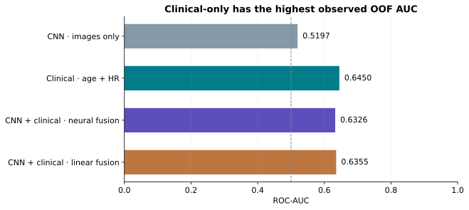
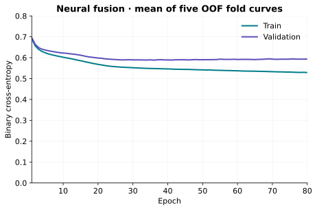

# DCE Research · CNN and clinical fusion

**Patient-level prediction of pathological complete response to breast cancer
treatment, with a CNN built from scratch and explicit clinical baselines.**

This academic research project asks whether pretreatment DCE-MRI adds predictive
information to age and hormone receptor status. It implements a compact image
encoder, a clinical model, neural and linear fusion, and patient-level evaluation.
The strongest observed OOF AUC belongs to the clinical baseline. Reporting that
result honestly is a central outcome of the project.

**Research only · no clinical use · no patient data or trained weights included.**

[Open the interactive website](https://aledeniiz.github.io/Cancer_mama_Jacinto/)
· [Go to the multimodal comparison](https://aledeniiz.github.io/Cancer_mama_Jacinto/#multimodal)


## Evidence at a glance

The four approaches below share the **five-fold OOF protocol with 1,092 eligible
development patients**. Higher AUC and lower BCE are preferable.

| Approach | ROC-AUC | BCE |
|---|---:|---:|
| CNN · images only | **0.5197** | 0.629661 |
| Clinical · age + HR | **0.6450** | 0.577562 |
| CNN + clinical · neural fusion | **0.6326** | 0.593395 |
| CNN + clinical · linear fusion | **0.6355** | 0.594180 |



Neural fusion improves numerically over CNN-only but **does not demonstrate an
advantage over clinical-only**. Its paired AUC difference against clinical-only
is −0.01245, with conditional 95% bootstrap interval [−0.03777, 0.01113].

**Separate historical result:** the EMA CNN reached TEST AUC **0.5524 on 176
patients** under a different protocol. It is not the matched OOF CNN result and
must not replace 0.5197 in this table. That TEST had previously been used with
other models. The final development-fitted multimodal checkpoint has **no
independent validation**, and its performance cannot be inferred directly from
the OOF fusion AUC.


Full-precision scalars and aggregate coordinates are in
[results/study.json](results/study.json); [provenance](results/provenance.json)
records the source hashes and export policy. No individual scores, thresholds,
labels or patient identifiers are distributed.

## What was built

- A **24,713-parameter CNN**: PRE/EARLY/LATE channels, four convolution/BatchNorm
  blocks, spatial pooling, 64-dimensional patient embedding, mean slice
  aggregation, dropout and linear output. No pretrained backbone.
- Training-only normalization, patient-disjoint partitions, evaluation with
  continuous scores, and EMA weight averaging with separate BatchNorm
  recalibration. EMA is a weight strategy, not a clinical input.
- Clinical median imputation/scaling and missingness encoding; standalone
  fold-specific logistic inference; frozen-image/clinical neural fusion.
- A controlled public copy of the **finished interactive platform**, preserving
  its Spanish interface, visual design, chapters and procedural CNN animations,
  plus code tests and reproducible figures. The public copy performs **no patient
  inference** and contains no patient imagery or institutional presentation assets.
  See [the precise privacy adaptations](web/PUBLIC_EXPORT.md).

## Dataset and units

The prepared experimental subset contains **1,273 patients**, **12,703 matched
slice triplets** and **38,109 phase PNG files**. Development contains 1,097
patients; exclusion of five unknown outcomes leaves 1,092 for the clinical/fusion
OOF analysis. These are not the complete 2,070-patient dataset described by the
source publication. Image count is not patient count.

The [original teaching-case access information](docs/original-data-access.md)
is preserved separately; replacing legacy files does not discard the origin of
the BreastDCEDL data.

Data are not redistributed. Obtain them through the
[version-specific BreastDCEDL record](https://zenodo.org/records/18114231), subject
to its CC BY-NC 4.0 terms and source-cohort conditions. See
[data access and schema](docs/datasets.md),
[methodology](docs/methodology.md) and [model availability](models/README.md).

## Installation

Use **Python 3.11** in a new environment. Install a compatible CPU PyTorch build
first, then the package; the public runtime uses corrected PyTorch 2.10.0 while
the historical experiments used 2.5.1. No retraining is implied by this runtime
change. Consult the [official PyTorch version instructions](https://pytorch.org/get-started/previous-versions/)
for platform-specific options.

```sh
python -m venv .venv
# Activate .venv using the command for your shell.
python -m pip install --upgrade pip
python -m pip install torch==2.10.0 --index-url https://download.pytorch.org/whl/cpu
python -m pip install -e ".[test,plots]"
```

The test and plot extras are optional for inference. Dependencies and supported
Python versions are declared in [pyproject.toml](pyproject.toml). The original
private environment and public tested environment are documented separately.

## Run the public edition

No patient data or checkpoints are needed for these commands:

```sh
python -B -m pytest -q
python -B scripts/render_results.py
python -B scripts/serve_web.py --port 8877
```

Open **http://127.0.0.1:8877/web/**. The server is local-only; this is not a
deployment. Static files must be served from the repository root so that the
finished platform's relative links resolve correctly. Its self-contained HTML
embeds sanitized aggregate evidence. Patient exploration and uploads/inference
are disabled with explicit notices because private resources are not distributed.



The plot is the mean of the five original neural-fusion fold histories, not
logistic-regression loss. The separate historical EMA development history is
[here](results/figures/historical_bce.svg). Curves start at epoch 1; TEST is not
shown as an epoch-by-epoch training curve.

## Authorized local data and model execution

Training, embedding extraction and inference require **separately authorized
local resources**. No weights are downloaded automatically. See
[models/README.md](models/README.md) and [examples](examples/README.md).
Inspect the actual command contracts first:

```sh
python scripts/train.py --help
python scripts/prepare_data.py --help
python scripts/evaluate.py --help
python scripts/infer_cnn.py --help
python scripts/extract_embeddings.py --help
python scripts/average_checkpoints.py --help
python scripts/infer_clinical.py --help
python scripts/infer_multimodal.py --help
```

The imaging loader accepts reviewed tensor bundles using JSON metadata and NPZ
arrays with pickle disabled. Historical `.pt` pickle files are not loaded by this
public edition; any trusted private conversion and prediction-parity check is a
separate authorized step. Missing resources produce explicit errors. The public
training path is a portable reference implementation of the preserved model and
recipe, not a claim of bitwise reproduction of the historical GPU experiment.

The **five clinical OOF models** are fold-specific evaluators. The private
preservation package reproduced all 1,092 OOF predictions with maximum error
2.22e-16 and unchanged AUC/BCE. Its parameters and patient-level references are
withheld here. No global clinical-only model existed in that study, and none is
fabricated. The **final neural-fusion model** is a distinct artifact fitted on
development data without an independent performance estimate.

## Tests

The suite exercises architecture, patient aggregation, preprocessing, split
independence, safe model loading and missing-artifact failures. Artificial
fixtures test software behavior only. Passing tests or re-rendering aggregate
curves **does not reproduce the scientific metrics** without the authorized
data, exact private artifacts and original experiment lineage.

See [verification evidence](docs/verification.md) for actual checks and limits.

## Limitations and reproducibility

The CNN is close to chance in matched OOF evaluation. Clinical-only has the
highest observed AUC, with no demonstrated fusion advantage. Reused development
data, cohort/label harmonization and historical label noise limit inference.
Intervals are conditional on selected models. There is no external prospective
validation, independent validation of the final fusion checkpoint or demonstrated
clinical utility. Read the [full limitations](docs/limitations.md).

This edition supports software inspection, aggregate-result exploration and
resource-gated execution. It deliberately cannot regenerate private scientific
evidence from the public checkout alone.

## Repository layout

```text
src/breastdce_research/  Models, preprocessing, training, evaluation and inference
scripts/               Explicit local-resource commands and aggregate plotting
configs/               Portable recipes, without local filesystem paths
tests/                 Software contracts using artificial fixtures
web/                   Finished platform copied with explicit privacy restrictions
results/               Verified aggregate evidence, provenance and figures
models/                Availability, format and lineage documentation; no weights
examples/              Permitted schema/usage examples
docs/                  Methods, data access, limits, rights and verification
```

## License and citation

The source project's **CC BY 4.0** license is preserved in [LICENSE](LICENSE).
See [NOTICE.md](NOTICE.md) for attribution and changes, and
[redistribution decisions](docs/redistribution.md) for the separate data and
asset terms. No UAX template/logo or presentation is included because its
redistribution rights were not established. No private local experiment history
was copied. The existing public repository retains its earlier commits; legacy
records were removed from the current tree, not purged from historical commits.

Fridman, N. et al. *BreastDCEDL: A standardized deep learning-ready breast
DCE-MRI dataset of 2,070 patients*. Scientific Data 13, 264 (2026).
[DOI: 10.1038/s41597-026-06589-6](https://doi.org/10.1038/s41597-026-06589-6).

The [deployment guide](docs/deployment.md) describes GitHub Pages and how to
verify the live site. Publication includes only the reviewed source and static
web export; data and model resources remain separate. The final inventory and
rights must be reviewed before future changes are committed.
